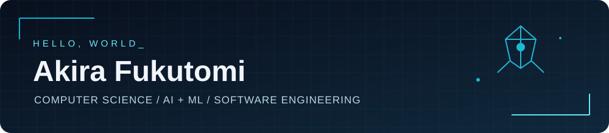
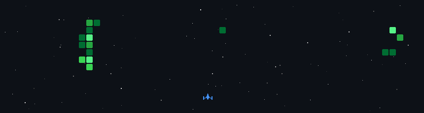

### Computer Science @ University of Southampton · AI/ML · Software Engineering · R&D

## About me

I'm **Akira**, a **BSc Computer Science student at the University of Southampton Malaysia** with a background in electrical and electronic engineering. I'm interested in **AI/ML, software engineering, and R&D**, especially where software interacts with real-world systems.

- **R&D experience:** Software Development Intern at **ViTrox Technologies**, working on industrial Automated X-ray Inspection (AXI) software and physical machine integration.
- **Machine learning:** Completed a summer programme at **Seoul National University**, applying polynomial regression and L2 regularisation.
- **What I enjoy building:** desktop applications, automation pipelines, data-driven tools, and hardware-connected software.
- **Languages:** Japanese (native) · Italian (native) · English (fluent) · Mandarin (intermediate).

## Experience & highlights

| Experience | Highlights |
| :--- | :--- |
| **Software Development Intern — R&D** · ViTrox Technologies (2026) | Built and tested a Kotlin / Compose Desktop control panel for industrial AXI software, including rail width, conveyor, clamps, barriers, and safety sensors; debugged UI, backend, and physical-machine integration. |
| **Machine Learning Summer Programme** · Seoul National University (2025) | Applied regression with polynomial features and L2 regularisation; supported by a University of Southampton Mobility Scholarship. |
| **Marketing / Product Assistant** · SaaS company (2024–2025) | Analysed customer LTV, churn, ARPU, and segments to support product and retention decisions; contributed to product testing and UI/UX improvements. |
| **Stanford e-Japan Award** · Stanford SPICE (2021) | Selected for the international education programme and received its top e-Japan award. |

## Tech arsenal

**Programming languages**

       

**Frameworks & development**

`Compose Desktop` · `MVVM` · `StateFlow` · `JavaFX` · `Git/GitHub` · `Linux` · `Shell scripting`

**Data & engineering tools**

    `Quartus / ModelSim` · `KiCad` · `Cisco Packet Tracer`

## Featured projects

| Project | What it does | Stack |
| :--- | :--- | :--- |
| [**Industrial Control Panel**](https://github.com/Akira5298/Industrial-Control-Panel) | Industrial machine control interface featuring reactive state management, multiple safety-related subsystems, and UI-to-backend integration. | Kotlin · Compose Desktop · MVVM · StateFlow |
| [**Gold Price Tracker**](https://github.com/Akira5298/Gold-Price-Tracker) | Automates gold-price collection, validation, deduplicated MySQL storage, scheduled runs, and trend visualisation. | Bash · MySQL · cron · GNUplot |
| [**Retail Management System**](https://github.com/Akira5298/Retail-Management-System) | Desktop retail app covering stock, checkout, discounts, order tracking, and PDF receipts. | Java · JavaFX · SQLite |
| [**Banking System**](https://github.com/Akira5298/Banking-System) | Console banking application with PIN authentication, transfers, validation, and persistent records. | C |

## Contribution arcade

### Space Shooter 🚀

  

### Contribution Snake 🐍

  <picture>
    <source media="(prefers-color-scheme: dark)" srcset="https://raw.githubusercontent.com/Akira5298/Akira5298/output/github-snake-dark.svg" />
    <source media="(prefers-color-scheme: light)" srcset="https://raw.githubusercontent.com/Akira5298/Akira5298/output/github-snake-light.svg" />
    
  </picture>

### Pac-Man 👻

  <picture>
    <source media="(prefers-color-scheme: dark)" srcset="https://raw.githubusercontent.com/Akira5298/Akira5298/output/pacman-contribution-graph-dark.svg" />
    <source media="(prefers-color-scheme: light)" srcset="https://raw.githubusercontent.com/Akira5298/Akira5298/output/pacman-contribution-graph.svg" />
    
  </picture>

### Breakout 🧱

  <picture>
    <source media="(prefers-color-scheme: dark)" srcset="https://raw.githubusercontent.com/Akira5298/Akira5298/output/breakout-contribution-graph-dark.svg" />
    <source media="(prefers-color-scheme: light)" srcset="https://raw.githubusercontent.com/Akira5298/Akira5298/output/breakout-contribution-graph.svg" />
    
  </picture>

All arcade visuals are generated automatically by GitHub Actions. After the first successful workflow runs, GitHub will publish the animated files and they will appear here.

---

Learn · Build · Iterate · Share

